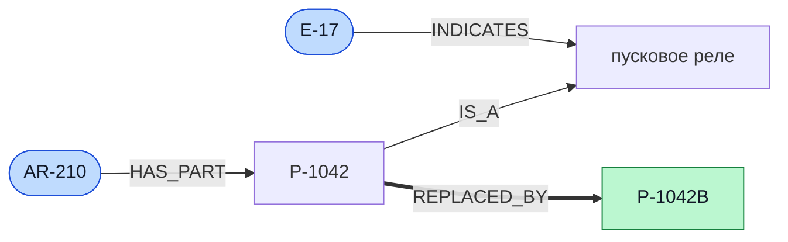
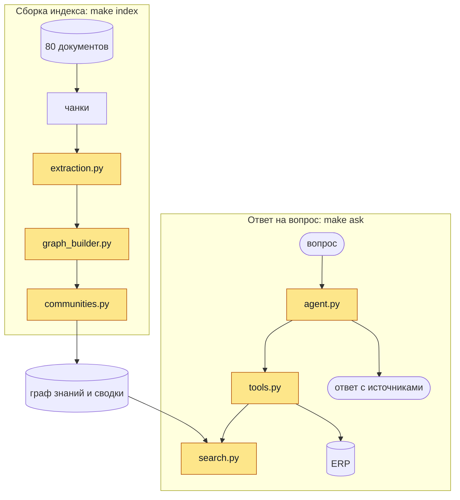

# Ассистент сервисной службы на Graph RAG


Команда из 2–3 человек дописывает ассистента, который отвечает диспетчеру сервисной службы по документам и данным учётной системы. Окружение, данные и тесты в репозитории уже есть. Вам предстоит написать шесть модулей: извлечение графа знаний из документов, поиск по графу и агента с инструментами.

## Задача

«ПолярТех» – вымышленная компания, которая производит и обслуживает холодильное оборудование для магазинов и складов. У неё три линейки: витрины «Арктика», моноблоки для холодильных камер «Бриз» и чиллеры «Гольфстрим», по четыре модели в каждой.

Когда витрина в магазине останавливается, товар портится. Поэтому в договорах записано время восстановления, а за его превышение компания платит штраф. Заявку принимает диспетчер: ему называют модель и код ошибки с панели управления. Чтобы отправить инженера с нужной деталью, диспетчер должен выяснить пять вещей:

1. какой узел отказал
2. какая деталь стоит на этом месте в этой модели
3. не снята ли она с производства и чем заменена
4. есть ли она на ближайшем складе
5. сколько она стоит

Ответы на первые три вопроса разбросаны по документам: руководствам по моделям, сервисным бюллетеням, регламентам ремонта и отчётам инженеров. Остатки и цены меняются каждый день и хранятся в учётной системе (ERP). ERP отмечает деталь, снятую с производства, и отклоняет её заказ. Чем деталь заменена, сказано только в бюллетене.

Сейчас диспетчер ищет деталь по документам в среднем 12 минут. Примерно в каждой двенадцатой заявке инженеру привозят деталь, снятую с производства, и выезд приходится повторять.

Ассистент должен отвечать на такие вопросы по документам и данным ERP, показывать источники ответа и готовить заказ детали, который подтверждает человек.

### Где ошибается плоский RAG

В репозитории есть готовый плоский RAG. Документы разбиты на чанки, для каждого чанка посчитан эмбеддинг, по вопросу находятся ближайшие чанки, и модель отвечает по ним. На открытых вопросах он отвечает верно в половине случаев и ошибается в трёх ситуациях.

- **Цепочка через несколько документов.** Вопрос: «Какую деталь заказать при ошибке E-17 на AR-210?» В руководстве сказано, что E-17 означает отказ пускового реле и что реле в AR-210 – это деталь P-1042. О том, что P-1042 снята с производства и заменена на P-1042B, сказано в бюллетене: в нём названы старая и новая деталь, вид узла и поставщик. Поиск по сходству с вопросом выбирает руководство и отчёты, и плоский RAG советует заказать P-1042. В графе знаний тот же ответ лежит на пути `E-17 -> пусковое реле -> P-1042 -> P-1042B`.
- **Обзорный вопрос.** «Какой узел чаще всего отказывает в линейке „Арктика“?» Ответ складывается из десятков отчётов.
- **Данные вне документов.** Остатки и цены можно узнать только запросом в ERP.

Так выглядит часть графа знаний для первого вопроса. Синим отмечены сущности из вопроса, зелёным – деталь, которую нужно заказать.



Первые две задачи решает Graph RAG, третью – агент с инструментами. Теория собрана в [`docs/theory.md`](docs/theory.md).

## Что уже есть в репозитории

- `data/` – 80 документов, словарь названий, 24 вопроса с эталонными ответами и эталон извлечения для 16 документов. Описание в [`docs/data.md`](docs/data.md)
- `erp/` – учётная система с остатками, ценами и заказами
- `src/assistant/infra/` – клиент модели с кешем на диске, чанкинг, плоский RAG, клиент ERP, сборка индекса, оценка, командная строка и HTTP API
- `tests/` – тесты платформы и 50 контрактных тестов на ваши функции
- `docker-compose.yml`, `Dockerfile`, `Makefile` – сборка и запуск

Модель по умолчанию – Qwen3 на 4 млрд параметров, квантованная до 4 бит. Она работает локально через Ollama на ноутбуке с 8 ГБ памяти и поддерживает вызов инструментов. Маленькая модель ошибается: путает направление связи, может выдумать код детали или подставить аргумент, которого никто не называл. Поэтому через все требования проходит одно правило: модель выбирает и формулирует, а факты проверяет код.

## Что нужно сделать

Вам предстоит дописать шесть файлов и подготовить отчёт. В каждом файле уже лежит заготовка: сигнатура функции, докстринг с требованиями и строка `raise NotImplementedError`.

На схеме эти файлы выделены жёлтым. Верхняя часть работает один раз при сборке индекса, нижняя – на каждый вопрос.



| Файл | Что написать | Требования |
| --- | --- | --- |
| `src/assistant/graphrag/extraction.py` | `extract_chunk`: извлечение сущностей и связей из чанка | FR-1 |
| `src/assistant/graphrag/graph_builder.py` | `build_graph`: сборка графа знаний | FR-2 |
| `src/assistant/graphrag/communities.py` | `detect_communities` и `summarize_community`: сообщества и их сводки | FR-3 |
| `src/assistant/graphrag/search.py` | `local_search` и `global_search`: два режима поиска по графу | FR-4, FR-5, FR-10 |
| `src/assistant/agent/tools.py` | `TOOL_SCHEMAS` и `build_tools`: пять инструментов агента | FR-6 |
| `src/assistant/agent/agent.py` | `run_agent`: цикл агента с проверками, повторами и подтверждением | FR-7, FR-8, FR-9, FR-10 |
| `REPORT.pdf` | отчёт в формате PDF: сравнение режимов и разбор ошибок | [`docs/submission.md`](docs/submission.md) |

Сигнатуры функций остаются как в заготовках: на них опираются сборка индекса, оценка и тесты. Вспомогательные функции и новые файлы добавляйте внутри `src/assistant/graphrag/` и `src/assistant/agent/`. Остальные файлы репозитория остаются как есть.

Требования FR-1 – FR-10, готовые функции и правила работы с кодом описаны в [`docs/requirements.md`](docs/requirements.md).

## Порядок работы

Каждый шаг заканчивается командой, которая показывает, что он сделан.

**1. Запустите проект.** Установка моделей и решение частых проблем описаны в [`docs/setup.md`](docs/setup.md).

```bash
cp .env.example .env
make up                    # собрать и запустить сервисы
make test                  # тесты платформы проходят, 50 контрактных пока падают
make eval MODE=baseline    # плоский RAG на открытых вопросах
```

Контрактные тесты пока падают с ошибкой `NotImplementedError`. Это список работ: тесты зеленеют по мере того, как вы пишете модули.

**2. Извлечение и граф.** Файлы `extraction.py` и `graph_builder.py`.

```bash
make test ARGS=tests/contract/test_extraction_and_graph.py
make eval-extraction       # Precision и Recall извлечения на 16 документах
```

**3. Сообщества и поиск.** Файлы `communities.py` и `search.py`.

```bash
make test ARGS=tests/contract/test_communities_and_search.py
make index                 # граф, сообщества и сводки по всему корпусу
make ask MODE=local Q="Какую деталь заказать при ошибке E-17 на AR-210?"
make eval MODE=local
make eval MODE=global
```

**4. Агент.** Файлы `tools.py` и `agent.py`.

```bash
make test ARGS=tests/contract/test_tools_and_agent.py
make ask MODE=agent        # вопрос по умолчанию: E-17 на AR-210, склад в Казани
make eval MODE=agent
```

**5. Итоговый прогон и отчёт.**

```bash
make test
make lint
make eval-all              # четыре режима на открытых вопросах
make eval-extraction
```

После этого подготовьте отчёт `REPORT.pdf` по плану из [`docs/submission.md`](docs/submission.md).

Сборка индекса идёт долго: модель вызывается на каждом из 92 чанков. Ответы модели сохраняются в `artifacts/llm_cache/`, поэтому повторный запуск с тем же запросом к модели занимает секунды.

## Как убедиться, что всё работает

| Команда | Что должно получиться |
| --- | --- |
| `make test` | все тесты проходят, в том числе 50 контрактных |
| `make lint` | `All checks passed!` |
| `make index` | в `artifacts/` появились `graph.json`, `communities.json` и `index_stats.json`, последняя строка вывода начинается со слов «индекс готов» |
| `make ask MODE=local Q="Какую деталь заказать при ошибке E-17 на AR-210?"` | в ответе названа P-1042B, в источниках есть `bulletin_SB-2025-03.md`. Плоский RAG на этот вопрос отвечает P-1042 |
| `make ask MODE=agent` | в ответе P-1042B, остаток 3 штуки в Казани и цена 2630 руб. Ниже напечатаны шаги: поиск по базе знаний, затем запросы в ERP |
| `make eval-all` | в `artifacts/` лежат `eval_baseline.json`, `eval_local.json`, `eval_global.json` и `eval_agent.json`. У плоского RAG доля верных ответов около 0.50 |
| `make eval-extraction` | в `artifacts/eval_extraction.json` записаны Precision и Recall по сущностям и связям |

Что именно измеряет оценка и как читать отчёты, описано в [`docs/evaluation.md`](docs/evaluation.md). Перед сдачей склонируйте репозиторий в пустую папку и пройдите эту таблицу ещё раз.

## Команда и защита

Проект выполняет команда из 2–3 человек в одном репозитории. Каждый участник защищает проект индивидуально: запускает ассистента на вопросе преподавателя и объясняет любую часть кода, в том числе написанную другими участниками. Правила сдачи и защиты описаны в [`docs/submission.md`](docs/submission.md), критерии оценки – в [`docs/rubric.md`](docs/rubric.md).

## Документы

| Документ | Что в нём |
| --- | --- |
| [`docs/setup.md`](docs/setup.md) | установка моделей, запуск, частые проблемы |
| [`docs/data.md`](docs/data.md) | корпус, схема графа, словарь названий, ERP, вопросы и эталон |
| [`docs/requirements.md`](docs/requirements.md) | требования FR-1 – FR-10, готовые функции, правила работы с кодом |
| [`docs/evaluation.md`](docs/evaluation.md) | метрики и отчёты оценки |
| [`docs/theory.md`](docs/theory.md) | графы знаний и Graph RAG со ссылками на статьи |
| [`docs/submission.md`](docs/submission.md) | состав команды, что сдавать, отчёт, защита |
| [`docs/rubric.md`](docs/rubric.md) | как выставляются 20 баллов |
