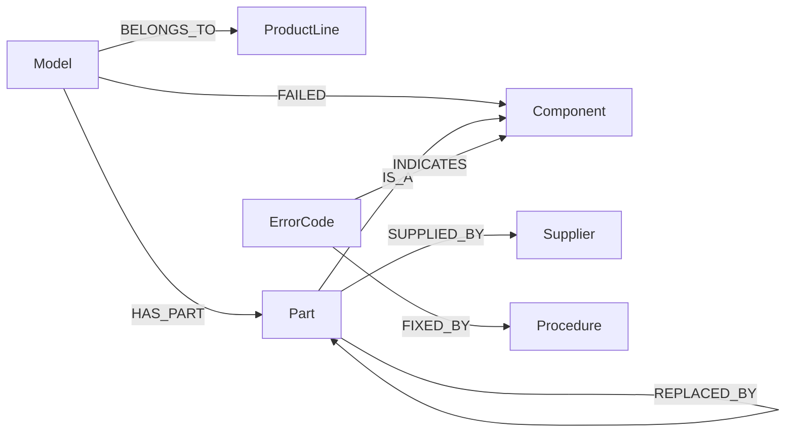

# Данные проекта

Данные лежат в папке `data/` и в сервисе `erp`. Они учебные и сгенерированы.

## Корпус

В `data/corpus/` лежат 80 документов в формате Markdown на русском языке.

| Вид документа | Сколько | Имя файла | Что в нём |
| --- | --- | --- | --- |
| Руководство по модели | 12 | `manual_AR-210.md` | линейка, состав узлов с номерами деталей и поставщиками, таблица кодов ошибок |
| Сервисный бюллетень | 10 | `bulletin_SB-2025-03.md` | замена детали, снятой с производства, или сообщение о дефекте партии |
| Регламент ремонта | 18 | `procedure_SP-104.md` | при какой ошибке применяется, порядок работ, норма времени |
| Отчёт о выезде | 40 | `report_R-2025-017.md` | модель, код ошибки, отказавший узел |

Руководство называет деталь, которая стояла в модели изначально. Если деталь позже сняли с производства, об этом сказано только в бюллетене. Бюллетень называет старую деталь, новую деталь, вид узла и поставщика.

В отчётах коды записаны небрежно: `ar 210`, `AR210`, `Е-17` с русской буквой «Е». Функции `find_codes` и `normalize_code` из `assistant.infra.grounding` приводят любую такую запись к каноническому виду.

Цены и остатки хранятся только в ERP.

Сборка индекса делит документы на 92 чанка. Чанк начинается с заголовка документа, поэтому из раздела «Состав узлов» понятно, о какой модели речь.

## Схема графа знаний

Извлекать нужно только эти типы сущностей и связей.



| Тип сущности | Как записывается имя | Пример |
| --- | --- | --- |
| `ProductLine` | название линейки | Арктика |
| `Model` | код модели | AR-210 |
| `Component` | название узла строчными буквами | пусковое реле |
| `Part` | номер детали | P-1042 |
| `ErrorCode` | код ошибки | E-17 |
| `Procedure` | номер регламента | SP-104 |
| `Supplier` | название поставщика | КомпрессорМаш |

| Тип связи | От кого к кому | Смысл |
| --- | --- | --- |
| `BELONGS_TO` | `Model -> ProductLine` | модель входит в линейку |
| `HAS_PART` | `Model -> Part` | в модели установлена деталь |
| `IS_A` | `Part -> Component` | деталь является узлом этого вида |
| `INDICATES` | `ErrorCode -> Component` | ошибка указывает на отказ узла |
| `FIXED_BY` | `ErrorCode -> Procedure` | ошибка устраняется по регламенту |
| `REPLACED_BY` | `Part -> Part` | деталь снята с производства и заменена |
| `SUPPLIED_BY` | `Part -> Supplier` | деталь поставляет поставщик |
| `FAILED` | `Model -> Component` | в отчёте о ремонте зафиксирован отказ узла |

Код ошибки означает одно и то же во всех моделях. В каждой модели на один вид узла приходится одна деталь. Замены бывают в два шага: `P-2054 -> P-2054B -> P-2054C`.

Номера бюллетеней и отчётов, например `SB-2025-03` и `R-2025-017`, служат именами документов. Схема в виде кода лежит в `assistant.infra.schemas`: константы `ENTITY_TYPES` и `RELATION_SIGNATURES`.

## Словарь названий

Файл `data/vocabulary.json` перечисляет все названия линеек, узлов и поставщиков, всего 21. В граф попадают только названия из словаря. Коды узнаются по виду: `AR-210`, `P-1042`, `E-17`, `SP-104`. Фрагмент файла:

```json
{
  "ProductLine": ["Арктика", "Бриз", "Гольфстрим"],
  "Component": ["компрессор", "вентилятор конденсатора", "датчик температуры"],
  "Supplier": ["АвтоматикаСевер", "ВентПром"]
}
```

Словарь возвращает функция `assistant.infra.config.vocabulary()`. У базы знаний он лежит в поле `KnowledgeBase.vocabulary`.

## ERP

Учётная система работает как отдельный сервис `erp`. В ней четыре склада: Москва, Санкт-Петербург, Казань, Новосибирск. Для каждой детали хранятся цена, остаток на каждом складе и признак `discontinued`: деталь снята с производства. Заказ такой детали ERP отклоняет.

Обращаться к ERP нужно через клиент `assistant.infra.erp_client.ErpClient`. У запроса три исхода.

| Исход | Как выглядит | Что значит |
| --- | --- | --- |
| Значение получено | метод вернул словарь | остаток 0 – тоже значение: деталь заведена в ERP, на этом складе она закончилась |
| Данных нет | исключение `ErpNotFound` | номер детали ERP неизвестен |
| Сервис недоступен | исключение `ErpUnavailable` | запрос можно повторить |

Четвёртый случай – исключение `ErpRejected`: ERP поняла запрос и отказала. Так бывает, если склад назван вне списка или деталь снята с производства. Такой запрос выполняется один раз.

Переменная `ERP_FAIL_RATE` в `.env` задаёт долю запросов, на которые ERP отвечает ошибкой. По умолчанию она равна 0. Чтобы проверить повторы, поставьте 0.3 и перезапустите сервисы.

## Вопросы

В `data/questions_dev.jsonl` лежат 24 открытых вопроса с эталонными ответами, по одному объекту JSON в строке.

| Тип | Сколько | Что проверяет | Пример |
| --- | --- | --- | --- |
| `local` | 5 | один факт | По какому регламенту устраняют ошибку E-17? |
| `multihop` | 7 | цепочка из нескольких связей через разные документы | Какую деталь заказать при ошибке E-17 на AR-210? |
| `global` | 4 | обзор по всему корпусу | Какой узел чаще всего отказывает в линейке «Арктика»? |
| `tool` | 5 | запрос в ERP, чаще всего после цепочки по графу | Сколько стоит деталь узла «контроллер» для модели BZ-110? |
| `refusal` | 3 | вопрос о модели, ошибке или детали, которая есть только в вопросе. Верный ответ – отказ | Сколько стоит деталь P-9999? |

Поля вопроса:

| Поле | Что в нём |
| --- | --- |
| `id`, `type`, `question` | номер, тип и текст вопроса |
| `key_facts` | ключевые факты ответа. Каждый факт – список допустимых написаний, например `["пусковое реле", "пускового реле"]` |
| `evidence` | связи графа, из которых складывается ответ |
| `source_groups` | документы-источники. Группа соответствует одной связи: достаточно назвать любой документ группы |
| `expected_calls` | вызовы инструментов, которые должен сделать агент |
| `expected_pending` | действие, которое агент должен вернуть на подтверждение |
| `must_refuse` | верный ответ на вопрос – отказ |

При проверке ассистент отвечает ещё на 24 скрытых вопроса того же состава.

## Эталон извлечения

В `data/gold_dev.json` записаны правильные сущности и связи для 16 документов: четырёх руководств, четырёх бюллетеней, четырёх регламентов и четырёх отчётов. По нему команда `make eval-extraction` считает Precision и Recall вашего извлечения.

У документа три списка:

- `entities` – сущности документа в виде `"Part:P-1042"`
- `relations` – связи, которые в тексте сказаны прямо. По ним считается Recall
- `optional_relations` – верные связи, которые из текста можно вывести. Найденная связь из этого списка засчитывается в Precision как верная

Регламент `procedure_SP-115.md` описывает плановые работы. Правильный результат извлечения для него – пустые списки.
