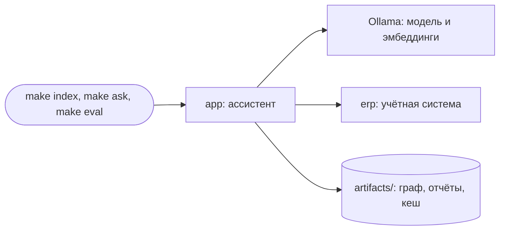

# Запуск проекта

Проект состоит из трёх сервисов. Сервис `app` запускает ваш код, сервис `erp` отвечает на запросы об остатках и ценах, Ollama обслуживает модель и эмбеддинги.



## Что нужно

- Docker с Docker Compose
- [Ollama](https://ollama.com) версии 0.15.4 или новее
- `make`. На Windows команды выполняются в WSL

Комфортно работать можно начиная с 8 ГБ оперативной памяти и 6 ГБ свободного места на диске.

## Модель

Модель запускается одним из двух способов.

**Ollama на вашем компьютере.** Способ для macOS и Windows: так модели доступен видеоускоритель.

```bash
ollama pull qwen3:4b-instruct-2507-q4_K_M
ollama pull bge-m3
```

В `.env` оставьте адрес `http://host.docker.internal:11434/v1`.

**Ollama в контейнере.** Способ для Linux.

```bash
make up-llm
make pull-models
```

В `.env` поставьте адрес `http://llm:11434/v1`.

Тег модели пишите полностью. Под коротким тегом `qwen3:4b` в Ollama лежит другая сборка: она рассуждает перед каждым ответом и работает медленнее.

## Команды

| Команда | Что делает |
| --- | --- |
| `make up` | собирает и запускает сервисы `app` и `erp` |
| `make index` | строит граф, сообщества и сводки вашими функциями |
| `make ask MODE=local Q="..."` | задаёт один вопрос в режиме `baseline`, `local`, `global` или `agent` |
| `make eval MODE=local` | прогоняет открытые вопросы в одном режиме |
| `make eval-all` | прогоняет открытые вопросы в четырёх режимах |
| `make eval-extraction` | измеряет качество извлечения на эталоне |
| `make test` | запускает все тесты. Один файл: `make test ARGS=tests/contract/test_tools_and_agent.py` |
| `make lint` | запускает линтер |
| `make down` | останавливает сервисы |

## Работа без Docker

Если установлен [uv](https://docs.astral.sh/uv/), те же команды работают без контейнеров. В `.env` укажите `LLM_BASE_URL=http://localhost:11434/v1`.

```bash
uv sync
uv run uvicorn erp.app:app --port 8100 &
make test RUN="uv run"
make eval MODE=baseline RUN="uv run"
```

## Частые проблемы

- **Сообщение «сервис модели недоступен».** Запустите Ollama и сверьте адрес в `.env`. Проверка: `curl http://localhost:11434/api/version`.
- **Модель отвечает очень медленно.** Проверьте тег модели и закройте другие тяжёлые программы. Быстрее всего работает запуск без Docker.
- **Числа в отчёте остаются прежними после правки кода.** Кеш возвращает сохранённый ответ на точно такой же запрос к модели. Чтобы пересчитать всё заново, удалите `artifacts/llm_cache/`.
