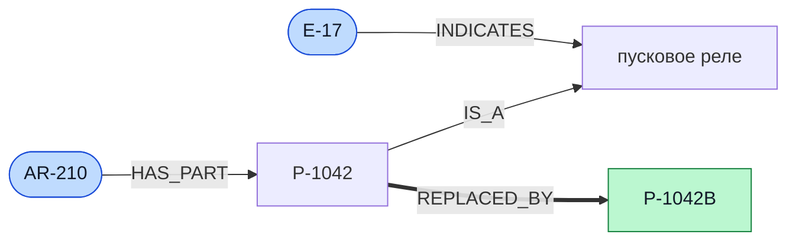
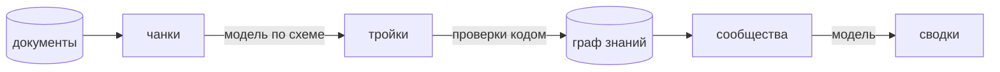
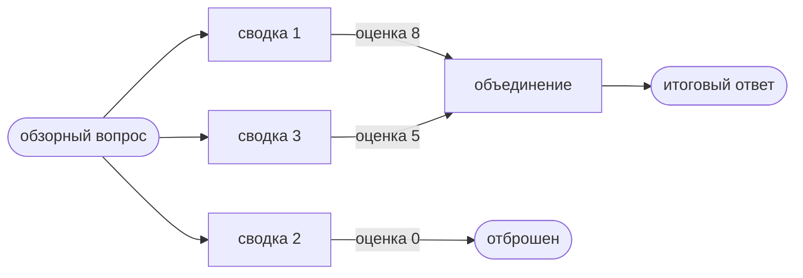
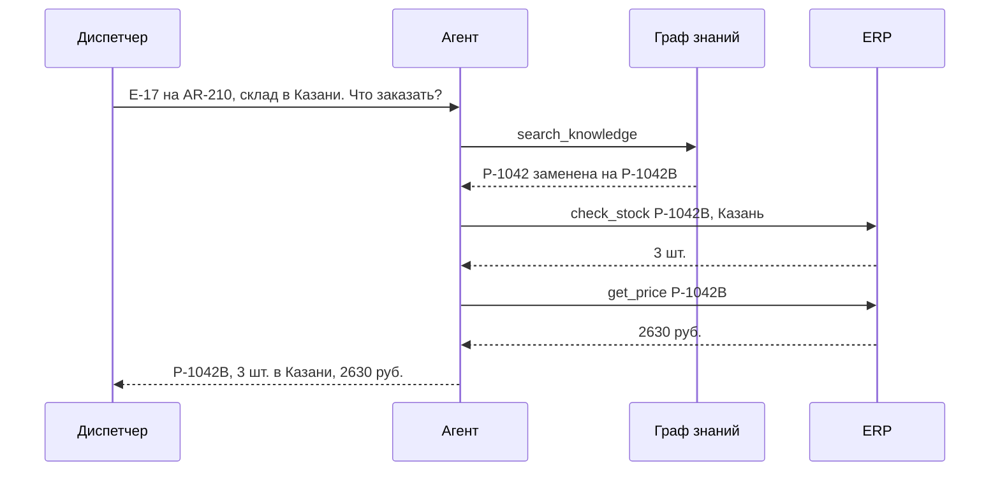

# Графы знаний и Graph RAG

В плоском RAG знания хранятся как набор чанков, а поиск выбирает те из них, что ближе всего к вопросу. Graph RAG добавляет к этому второй слой: связи между сущностями, о которых говорят документы. Ниже разобрано, зачем этот слой нужен, как его строит языковая модель и как по нему отвечать на вопросы.

## Где плоский поиск теряет ответ

Плоский RAG хорошо работает, когда ответ лежит в одном чанке и этот чанк похож на вопрос. Посмотрим на вопрос диспетчера: «Какую деталь заказать при ошибке E-17 на AR-210?»

Ответ складывается из трёх фактов. Ошибка E-17 указывает на пусковое реле. Реле в модели AR-210 – это деталь P-1042. Деталь P-1042 заменена на P-1042B. Первые два факта записаны в руководстве, и оно похоже на вопрос: в нём есть и код ошибки, и модель. Третий факт записан в бюллетене, где названы старая и новая деталь, вид узла и поставщик. Поиск по сходству выбирает руководство и отчёты, и ассистент советует заказать P-1042.

Почему так происходит? Факты связаны через общую сущность, деталь P-1042, а эмбеддинг чанка хранит смысл текста целиком, без отдельных сущностей. Чтобы пройти цепочку, связи между сущностями нужно записать явно.

Второй трудный случай – обзорный вопрос: «Какой узел чаще всего отказывает в линейке „Арктика“?» Ответ на него – итог по десяткам отчётов, а четыре ближайших чанка дают четыре отдельных отчёта.

> **Ключевой тезис:** плоский RAG ищет текст, похожий на вопрос. Graph RAG ищет сущности из вопроса и идёт от них по связям.

## Факты как тройки

Граф знаний хранит факты в виде троек «субъект, отношение, объект». Наш пример записывается так:

```
(E-17,    INDICATES,   пусковое реле)
(AR-210,  HAS_PART,    P-1042)
(P-1042,  IS_A,        пусковое реле)
(P-1042,  REPLACED_BY, P-1042B)
```

Сущности становятся узлами, отношения – направленными рёбрами.



Вопрос диспетчера превращается в обход графа: от узлов `E-17` и `AR-210` по рёбрам к узлу `P-1042B`. Бюллетеню теперь достаточно упомянуть деталь, до которой дошёл обход.

Набор допустимых типов сущностей и отношений называется схемой. Схема проекта описана в [`data.md`](data.md). Она ограничивает модель при извлечении и позволяет проверять результат автоматически.

У каждого ребра хранятся два служебных атрибута. Источники говорят, из каких чанков получен факт: по ним ассистент показывает, откуда взят ответ. Вес говорит, в скольких чанках факт встретился. Отказ узла из восьми отчётов и отказ из одного отчёта различаются именно весом, и на весах строятся ответы на обзорные вопросы.

## Граф строит языковая модель

Раньше тройки извлекали специальными моделями, обученными под конкретную область. В Graph RAG [1] это делает языковая модель общего назначения: ей показывают чанк и схему и просят вернуть сущности и связи в формате JSON. Запрос состоит из четырёх частей: описание задачи, схема с направлением каждого отношения, один или два примера и требование к формату ответа. Температура нулевая, чтобы повторный запуск давал тот же граф.



Маленькая модель при извлечении ошибается, и её ошибки хорошо изучены. Для каждой есть приём.

| Ошибка | Пример | Приём |
| --- | --- | --- |
| Разные написания одной сущности | `AR-210`, `ar 210`, `AR210` | привести имена к каноническому виду |
| Отношение вне схемы | замена, которая соединяет модель и деталь | проверить типы концов по схеме |
| Выдуманное имя | в тексте `SP-104`, в ответе `SP-1-04` | принять код, только если он есть в чанке |
| Перевёрнутое направление | новая деталь «заменена» старой | описать направление в запросе, дать пример, сравнить веса встречных рёбер |

Последняя ошибка отличается от остальных: проверка по схеме её пропускает, потому что типы концов верны. Её находят при сборке графа, когда сравнивают веса встречных рёбер.

## От графа к обзору: сообщества и сводки

Для обзорных вопросов граф разбивают на тематические группы и описывают каждую. Группа тесно связанных узлов называется сообществом. В графе проекта сообществом оказывается, например, линейка «Арктика» со своими моделями, деталями и типичными отказами.

Качество разбиения измеряет модульность. В хорошем сообществе рёбер внутри заметно больше, чем было бы при случайной расстановке рёбер с теми же степенями узлов.

$$Q = \frac{1}{2m} \sum_{i,j} \left[ A_{ij} - \frac{k_i k_j}{2m} \right] \delta(c_i, c_j)$$

Здесь $A_{ij}$ – вес ребра между узлами $i$ и $j$, $k_i$ – сумма весов рёбер узла $i$, $m$ – сумма весов всех рёбер, а $\delta(c_i, c_j)$ равна 1, если узлы лежат в одном сообществе, и 0 иначе. Слагаемое $\frac{k_i k_j}{2m}$ – ожидаемый вес ребра в случайном графе. Чем больше $Q$, тем сильнее реальные связи внутри сообществ превышают случайные.

Алгоритм Лувена [2] ищет разбиение с большой модульностью жадно. Сначала каждый узел переходит в сообщество соседа, если это увеличивает $Q$. Затем сообщества сжимаются в узлы нового графа, и шаг повторяется. В `networkx` это функция `louvain_communities` [3]: параметр `weight` учитывает веса рёбер, `seed` делает результат воспроизводимым, `resolution` управляет размером сообществ.

Для каждого сообщества модель один раз пишет сводку: какие сущности в него входят, как они связаны, что встречается чаще всего. Числа для сводки считает код по весам рёбер, модель их только формулирует.

## Два режима поиска

После индексации у системы есть граф и сводки. Отвечать по ним можно двумя способами.

**Режим local** отвечает на вопросы о конкретных сущностях. Сначала в вопросе находят опорные сущности: в проекте это коды и названия из словаря. Затем берут часть графа вокруг них. Для одной сущности это её окрестность. Для нескольких полезнее пути между ними: код E-17 означает одно и то же во всех витринах, и от него через «пусковое реле» достижимы реле разных моделей. Нужная деталь лежит на пути между E-17 и AR-210, и таких путей единицы. Найденные факты передают модели, и она отвечает по ним.

**Режим global** отвечает на обзорные вопросы по схеме «разделить и объединить». На шаге map вопрос задают каждой сводке, и модель возвращает частичный ответ с оценкой его полезности. На шаге reduce полезные частичные ответы объединяются в итоговый.



| | Режим local | Режим global |
| --- | --- | --- |
| Вопрос | про конкретную сущность или цепочку | про корпус в целом |
| Что читает модель | факты из графа | сводки сообществ |
| Вызовов модели на вопрос | один | по одному на сообщество и ещё один |

В таблице видна цена подхода. Плоскому RAG для индексации хватает эмбеддингов. Graph RAG вызывает модель на каждом из $N$ чанков и на каждом из $C$ сообществ, а ответ в режиме global стоит ещё $C + 1$ вызовов. Эти числа в проекте измеряются, и их сопоставляют с тем, насколько выросла доля верных ответов.

## Агент: статические и динамические знания

Знания ассистента бывают двух видов. Статические лежат в документах, и их достаёт поиск. Динамические меняются во времени, и их получают вызовом функции. В проекте состав моделей, ошибки и замены деталей хранятся в графе, а остатки и цены – в ERP.

Агент связывает обе части в цикле ReAct [4]: рассуждение, действие, наблюдение. Поиск по графу для него такой же инструмент, как запрос остатка. На вопрос диспетчера он сначала вызывает поиск по базе знаний и узнаёт номер актуальной детали, затем с этим номером обращается в ERP.



Маленькая модель в этом цикле может назвать склад вне списка, подставить своё количество или пересказать «данных нет» как «на складе ноль». Поэтому код проверяет аргументы до вызова и сверяет коды и числа в готовом ответе с результатами инструментов. Заказ детали агент возвращает человеку на подтверждение.

## Как это измерить

Ответ считается верным, если содержит все ключевые факты эталона: коды, числа и названия.

Качество извлечения измеряют две метрики. Пусть $G$ – множество эталонных троек, а $E$ – множество извлечённых.

$$\text{Precision} = \frac{|E \cap G|}{|E|}, \qquad \text{Recall} = \frac{|E \cap G|}{|G|}$$

Precision показывает, какая доля извлечённого верна. Recall показывает, какая доля нужного найдена. Для графа знаний Recall обычно важнее: потерянное ребро обрывает цепочку, и многошаговый вопрос остаётся без ответа.

Отдельно считают долю ответов с выдуманными фактами: кодами вне корпуса и числами вне результатов инструментов. Почему отдельно? Ответ «не знаю» неверен, но безвреден. Уверенный ответ с выдуманной деталью приводит к неверному заказу.

## Что почитать

1. Edge et al. From Local to Global: A Graph RAG Approach to Query-Focused Summarization. 2024. Исходная статья о Graph RAG: извлечение, сообщества, сводки, два режима поиска. <https://arxiv.org/abs/2404.16130>
2. Blondel et al. Fast unfolding of communities in large networks. 2008. Алгоритм Лувена. <https://arxiv.org/abs/0803.0476>
3. Документация NetworkX, функция `louvain_communities`. <https://networkx.org/documentation/stable/reference/algorithms/generated/networkx.algorithms.community.louvain.louvain_communities.html>
4. Yao et al. ReAct: Synergizing Reasoning and Acting in Language Models. 2022. Цикл агента. <https://arxiv.org/abs/2210.03629>
5. Lewis et al. Retrieval-Augmented Generation for Knowledge-Intensive NLP Tasks. 2020. Исходная статья о RAG. <https://arxiv.org/abs/2005.11401>
6. Yang et al. HotpotQA: A Dataset for Diverse, Explainable Multi-hop Question Answering. 2018. Как устроены и оцениваются многошаговые вопросы. <https://arxiv.org/abs/1809.09600>
7. Pan et al. Unifying Large Language Models and Knowledge Graphs: A Roadmap. 2023. Обзор о совместной работе моделей и графов знаний. <https://arxiv.org/abs/2306.08302>
8. Peng et al. Graph Retrieval-Augmented Generation: A Survey. 2024. Обзор методов Graph RAG. <https://arxiv.org/abs/2408.08921>
9. Guo et al. LightRAG: Simple and Fast Retrieval-Augmented Generation. 2024. Более дешёвый вариант с поиском по ключевым словам двух уровней. <https://arxiv.org/abs/2410.05779>
10. Sun et al. Think-on-Graph: Deep and Responsible Reasoning of Large Language Model on Knowledge Graph. 2023. Модель сама идёт по графу шаг за шагом. <https://arxiv.org/abs/2307.07697>
